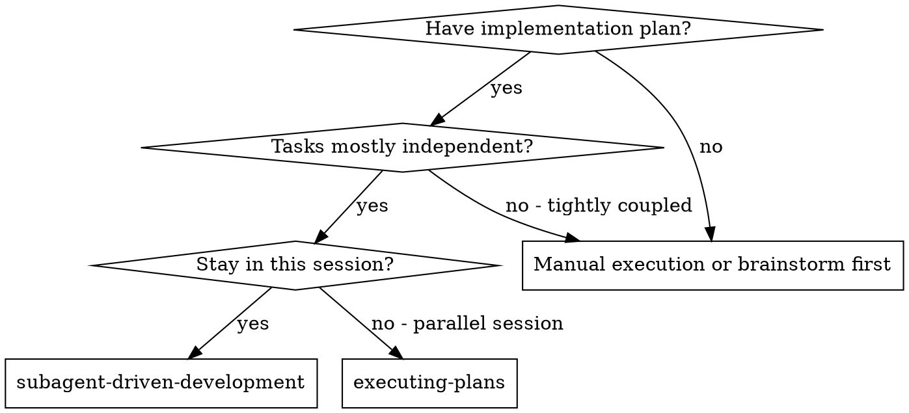

# Subagent-Driven Development

Execute plan by dispatching fresh subagent per task, with two-stage review after each: spec compliance review first, then code quality review.

Read and follow [the shared subagent workflow](../../../.claude/rules-snippets/subagent-workflow.md#split-before-dispatch) to identify every ready independent lane in each authorized phase and after each reconciled batch. This skill retains per-task review requirements; it does not require implementation to be globally serial.

**Core principle:** Fresh subagents for independently scoped planned work + two-stage review (spec then quality) = high quality, fast iteration

## When to Use



**vs. Executing Plans (parallel session):**

- Same session (no context switch)
- Fresh subagent per task (no context pollution)
- Two-stage review after each task: spec compliance first, then code quality
- Faster iteration (no human-in-loop between tasks)

## Direct Entry and Plan Changes

This skill starts only from a plan that has an explicit plan review PASS and any applicable existing confirmation, including when it is invoked directly rather than from Factory or another gate. Each finding is classified before repair. An ordinary repair stays with the implementer. A consequential finding (scope, approach, requirement, or plan) exits the implementer loop: the implementer stops and reports it, the coordinator sends it to the planner for revision, plan review, and any applicable confirmation, and the work resumes from there. Spec compliance review still runs before code quality review.

One broad planned task may use multiple scoped execution lanes when each lane's brief is bounded by the task's original acceptance criteria and has settled inputs and a disjoint writable scope. If the work is coupled or cannot be divided without changing those criteria, keep it with one owner or run it serially. When using `./implementer-prompt.md` for a lane, provide its bounded task context directly at dispatch and explicitly override its commit step: lane workers do not stage or commit; one coordinator owns integration and the index.

Review each reconciled lane against its actual scoped changes, including the current uncommitted diff rather than relying only on `BASE_SHA..HEAD_SHA`. Include newly created untracked paths in the review input when relevant. Keep spec review before quality review and retain the same acceptance criteria.

## The Process

```dot
digraph process {
    rankdir=TB;

    subgraph cluster_per_task {
        label="Per Task";
        "Dispatch implementer subagent (./implementer-prompt.md)" [shape=box];
        "Implementer subagent asks questions?" [shape=diamond];
        "Answer questions, provide context" [shape=box];
        "Implementer subagent implements, tests, self-reviews; no staging or commits" [shape=box];
        "Dispatch spec reviewer with reconciled scoped changes, including relevant uncommitted and untracked paths" [shape=box];
        "Spec reviewer subagent confirms code matches spec?" [shape=diamond];
        "Implementer subagent fixes spec gaps" [shape=box];
        "Dispatch code quality reviewer with reconciled scoped changes, including relevant uncommitted and untracked paths" [shape=box];
        "Code quality reviewer subagent approves?" [shape=diamond];
        "Implementer subagent fixes quality issues" [shape=box];
        "Mark task complete in TodoWrite" [shape=box];
    }

    "Read plan, extract all tasks with full text, note context, create TodoWrite" [shape=box];
    "More tasks remain?" [shape=diamond];
    "Dispatch final code reviewer subagent for entire implementation" [shape=box];
    "Use superpowers:finishing-a-development-branch" [shape=box style=filled fillcolor=lightgreen];

    "Consequential change needed?" [shape=diamond];
    "Exit: coordinator sends to planner (revision, plan review, confirmation)" [shape=box];

    "Read plan, extract all tasks with full text, note context, create TodoWrite" -> "Dispatch implementer subagent (./implementer-prompt.md)";
    "Dispatch implementer subagent (./implementer-prompt.md)" -> "Implementer subagent asks questions?";
    "Implementer subagent asks questions?" -> "Answer questions, provide context" [label="yes"];
    "Answer questions, provide context" -> "Dispatch implementer subagent (./implementer-prompt.md)";
    "Implementer subagent asks questions?" -> "Implementer subagent implements, tests, self-reviews; no staging or commits" [label="no"];
    "Implementer subagent implements, tests, self-reviews; no staging or commits" -> "Consequential change needed?";
    "Consequential change needed?" -> "Exit: coordinator sends to planner (revision, plan review, confirmation)" [label="yes"];
    "Consequential change needed?" -> "Dispatch spec reviewer with reconciled scoped changes, including relevant uncommitted and untracked paths" [label="no"];
    "Dispatch spec reviewer with reconciled scoped changes, including relevant uncommitted and untracked paths" -> "Spec reviewer subagent confirms code matches spec?";
    "Spec reviewer subagent confirms code matches spec?" -> "Implementer subagent fixes spec gaps" [label="no: ordinary gap"];
    "Spec reviewer subagent confirms code matches spec?" -> "Exit: coordinator sends to planner (revision, plan review, confirmation)" [label="no: consequential gap"];
    "Implementer subagent fixes spec gaps" -> "Dispatch spec reviewer with reconciled scoped changes, including relevant uncommitted and untracked paths" [label="re-review"];
    "Spec reviewer subagent confirms code matches spec?" -> "Dispatch code quality reviewer with reconciled scoped changes, including relevant uncommitted and untracked paths" [label="yes"];
    "Dispatch code quality reviewer with reconciled scoped changes, including relevant uncommitted and untracked paths" -> "Code quality reviewer subagent approves?";
    "Code quality reviewer subagent approves?" -> "Implementer subagent fixes quality issues" [label="no: ordinary issue"];
    "Code quality reviewer subagent approves?" -> "Exit: coordinator sends to planner (revision, plan review, confirmation)" [label="no: consequential issue"];
    "Implementer subagent fixes quality issues" -> "Dispatch code quality reviewer with reconciled scoped changes, including relevant uncommitted and untracked paths" [label="re-review"];
    "Code quality reviewer subagent approves?" -> "Mark task complete in TodoWrite" [label="yes"];
    "Mark task complete in TodoWrite" -> "Reconcile batch and dispatch next ready lanes";
    "Reconcile batch and dispatch next ready lanes" -> "Dispatch implementer subagent (./implementer-prompt.md)" [label="ready lane"];
    "Reconcile batch and dispatch next ready lanes" -> "Dispatch final code reviewer subagent for entire implementation" [label="all tasks complete"];
    "Dispatch final code reviewer subagent for entire implementation" -> "Use superpowers:finishing-a-development-branch";
}
```



## Prompt Templates

- `./implementer-prompt.md` - Dispatch implementer subagent
- `./spec-reviewer-prompt.md` - Dispatch spec compliance reviewer subagent
- `./code-quality-reviewer-prompt.md` - Dispatch code quality reviewer subagent

## Example Workflow

```
You: I'm using Subagent-Driven Development to execute this plan.

[Read plan file once: apps/{{APP_NAME}}/docs/features/{{ISSUE_ID}}-{{FEATURE_NAME}}/plan.md]
[Check the explicit plan review PASS and any applicable confirmation first: stop if either is missing]
[Extract all 5 tasks with full text and context]
[Create TodoWrite with all tasks]

Task 1: Hook installation script

[Get Task 1 text and context (already extracted)]
[Dispatch implementation subagent with full task text + context]

Implementer: "Before I begin - should the hook be installed at user or system level?"

You: "User level (~/.config/superpowers/hooks/)"

Implementer: "Got it. Implementing now..."
[Later] Implementer:
  - Implemented install-hook command
  - Added tests, 5/5 passing
  - Self-review: Found I missed --force flag, added it
  - Left changes uncommitted for coordinator integration

[Dispatch spec compliance reviewer]
Spec reviewer: ✅ Spec compliant - all requirements met, nothing extra

[Reconcile changed paths and the lane's uncommitted diff, including relevant untracked paths; dispatch code quality reviewer with those changes]
Code reviewer: Strengths: Good test coverage, clean. Issues: None. Approved.

[Mark Task 1 complete]

Task 2: Recovery modes

[Get Task 2 text and context (already extracted)]
[Dispatch implementation subagent with full task text + context]

Implementer: [No questions, proceeds]
Implementer:
  - Added verify/repair modes
  - 8/8 tests passing
  - Self-review: All good
  - Left changes uncommitted for coordinator integration

[Dispatch spec compliance reviewer]
Spec reviewer: ❌ Issues:
  - Missing: Progress reporting (spec says "report every 100 items")
  - Extra: Added --json flag (not requested)

[Implementer fixes issues]
Implementer: Removed --json flag, added progress reporting

[Spec reviewer reviews again]
Spec reviewer: ✅ Spec compliant now

[Dispatch code quality reviewer]
Code reviewer: Strengths: Solid. Issues (Important): Magic number (100)

[Implementer fixes]
Implementer: Extracted PROGRESS_INTERVAL constant

[Code reviewer reviews again]
Code reviewer: ✅ Approved

[Mark Task 2 complete]

...

[After all tasks]
[Dispatch final code-reviewer]
Final reviewer: All requirements met, ready to merge

Done!
```

## Advantages

**vs. Manual execution:**

- Subagents follow TDD naturally
- Fresh context per task (no confusion)
- Parallel-safe (subagents don't interfere)
- Subagent can ask questions (before AND during work)

**vs. Executing Plans:**

- Same session (no handoff)
- Continuous progress (no waiting)
- Review checkpoints automatic

**Efficiency gains:**

- No file reading overhead (controller provides full text)
- Controller curates exactly what context is needed
- Subagent gets complete information upfront
- Questions surfaced before work begins (not after)

**Quality gates:**

- Self-review catches issues before handoff
- Two-stage review: spec compliance, then code quality
- Review loops ensure fixes actually work
- Spec compliance prevents over/under-building
- Code quality ensures implementation is well-built

**Cost:**

- More subagent invocations (implementer + 2 reviewers per task)
- Controller does more prep work (extracting all tasks upfront)
- Review loops add iterations
- But catches issues early (cheaper than debugging later)

## Red Flags

**Never:**

- Skip reviews (spec compliance OR code quality)
- Proceed with unfixed issues
- Dispatch overlapping writers concurrently
- Make subagent read plan file (provide full text instead)
- Skip scene-setting context (subagent needs to understand where task fits)
- Ignore subagent questions (answer before letting them proceed)
- Accept "close enough" on spec compliance (spec reviewer found issues = not done)
- Skip review loops (reviewer found ordinary issues = implementer fixes = review again; consequential findings go to the coordinator)
- Let implementer self-review replace actual review (both are needed)
- **Start code quality review before spec compliance is ✅** (wrong order)
- Dispatch a dependent lane before its prerequisite output or shared write is reconciled

Independent tasks may be implemented or reviewed in parallel when their writable scopes and inputs are independent. Keep each task's spec review before its quality review, and complete ordinary repairs and their re-review before treating that task as accepted. Dependents wait for reconciled reviews; do not duplicate settled verification.

**If subagent asks questions:**

- Answer clearly and completely
- Provide additional context if needed
- Don't rush them into implementation

**If reviewer finds issues:**

- Implementer (same subagent) fixes each ordinary issue. A consequential finding (scope, approach, requirement, or plan) is not fixed here: it goes to the coordinator for the planner, plan review, and any applicable confirmation (see Direct Entry and Plan Changes).
- Reviewer reviews again
- Repeat until approved
- Don't skip the re-review

**If subagent fails task:**

- Dispatch fix subagent with specific instructions
- Don't try to fix manually (context pollution)

## Domain-Aware Dispatch

When dispatching an implementer subagent, choose the agent whose expertise matches the task domain:

| Task Domain                                   | Agent                  | When to Use                                               |
| --------------------------------------------- | ---------------------- | --------------------------------------------------------- |
| API design, databases, system architecture    | **Backend Architect**  | Schema changes, service layer, auth, performance          |
| UI components, state management, styling      | **Frontend Developer** | Components, layouts, responsive design, accessibility     |
| API contracts, docs, versioning               | **API Specialist**     | OpenAPI specs, client SDKs, API versioning, integration   |
| Admin dashboards, RBAC, reporting, monitoring | **Admin Portal**       | Admin panels, roles/permissions, analytics, system health |
| Documentation                                 | **Documenter**         | README updates, ADRs, API docs, AGENTS.md                 |
| General implementation                        | **Implementer**        | Tasks that don't fit a specialist domain                  |

**Multi-domain tasks:** If a task spans domains (e.g., "add endpoint with UI"), dispatch the primary domain specialist and note the secondary concern. For example, dispatch **Backend Architect** for the endpoint, then **Frontend Developer** for the UI — as separate tasks.

The implementer-prompt.md template works for any of these agents — just specify which agent to dispatch.

## Integration

**Required workflow skills:**

- **superpowers:writing-plans** - Creates the plan this skill executes
- **superpowers:requesting-code-review** - Code review template for reviewer subagents
- **superpowers:finishing-a-development-branch** - Complete development after all tasks

**Subagents should use:**

- **superpowers:test-driven-development** - Subagents follow TDD for each task

**Domain specialist agents (see `.github/agents/` or `.cursor/agents/`):**

- **Backend Architect** - Backend and infrastructure tasks
- **Frontend Developer** - UI and frontend tasks
- **API Specialist** - API contract and integration tasks
- **Admin Portal** - Admin dashboards, RBAC, reporting, monitoring tasks
- **Documenter** - Documentation tasks
- **Reviewer** - Code review (replaces generic code quality reviewer when invoked directly)

**Alternative workflow:**

- **superpowers:executing-plans** - Use for parallel session instead of same-session execution
